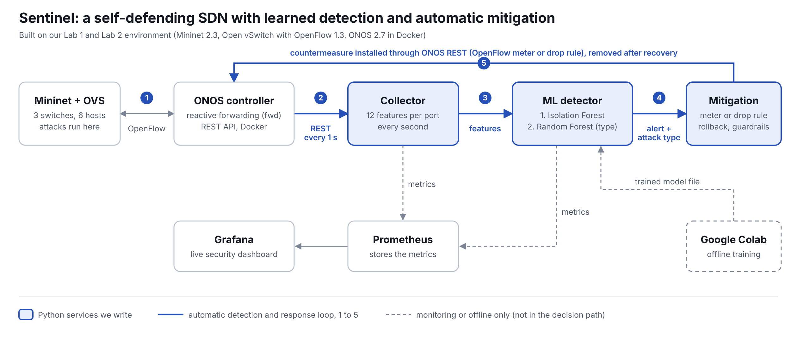

# Sentinel: a self-defending SDN

Group project for the **Security of SDN** course, University of Luxembourg.

Sentinel is a closed control loop that defends a software-defined network **without a human in the
loop**. It watches the ONOS control plane one switch port at a time, uses a two-stage machine
learning model to decide whether a port is attacking the controller and what kind of attack it is,
and installs the matching countermeasure automatically through the ONOS REST API. Every rule it
installs is removed again on its own, decided from what the switch actually measures, not from a
timer. A Prometheus and Grafana dashboard shows the whole loop live. The Lab 2 threshold rule is
kept as a baseline that the ML detector has to beat, and it does: the detector catches the slow and
pulsed floods that walk straight under a fixed threshold.

The loop is: an attack reaches ONOS, the detector flags the port and names the attack, the engine
installs a meter or drop rule on that one port, and the rule is removed again once the switch
counters show the attack has stopped. The figure in [Architecture](#architecture) shows it in full.

| Person | Role | Main folders |
| --- | --- | --- |
| Ilias | Testbed and red team | `topo/`, `scenarios/` |
| Aishwarya | ML detection | `sentinel/features.py`, `sentinel/detector.py`, `notebooks/` |
| Abdou | Mitigation engine | `sentinel/engine.py`, `sentinel/onos_client.py`, `sentinel/playbooks.yaml` |
| Nkwenti | Dashboard and evaluation | `monitoring/`, `eval/` |

---

## Contents

1. [How it works](#how-it-works)
2. [Architecture](#architecture)
3. [Requirements](#requirements)
4. [Quick start (one command)](#quick-start-one-command)
5. [Manual setup, step by step](#manual-setup-step-by-step)
6. [Check that everything works](#check-that-everything-works)
7. [Running attacks and watching the loop](#running-attacks-and-watching-the-loop)
8. [Experiments you can run](#experiments-you-can-run)
9. [The detection model](#the-detection-model)
10. [The mitigation engine](#the-mitigation-engine)
11. [The dashboard and evaluation](#the-dashboard-and-evaluation)
12. [Data and model training](#data-and-model-training)
13. [Results](#results)
14. [Repository layout](#repository-layout)
15. [Shared contracts](#shared-contracts)
16. [How we work with Git](#how-we-work-with-git)
17. [Troubleshooting](#troubleshooting)
18. [Deep-dive documents](#deep-dive-documents)
19. [What never goes in this repo](#what-never-goes-in-this-repo)

---

## How it works

Sentinel is five parts that form one loop. Each part is owned by one person and has its own
deep-dive document (see [Deep-dive documents](#deep-dive-documents)).

1. **Testbed (`topo/`, `scenarios/`).** A Mininet network of 6 hosts and 3 Open vSwitch switches
   controlled by ONOS 2.7.0. A traffic generator produces normal traffic (pings, bulk transfers,
   mixed), and four attack scenarios produce the threats: a constant flood, a slow flood, a pulsed
   flood, and identity spoofing. A scenario runner plays each attack on a fixed timeline and a raw
   recorder photographs ONOS state so the data can be labelled and used for training.

2. **Detection (`sentinel/detector.py`, `sentinel/features.py`).** Every 2 seconds the detector
   polls the ONOS REST API, turns the raw state into features for each edge port over a 10 second
   window, and scores every port with a two-stage model. An **Isolation Forest** trained only on
   normal traffic decides whether a port is abnormal; a **Random Forest** then names the attack
   type. A separate identity check catches spoofing, which is too quiet to stand out by volume.
   When a port looks like an attack, the detector calls the engine.

3. **Mitigation (`sentinel/engine.py`).** A small HTTP service that receives an alert and installs
   the countermeasure for that attack type on that one switch port through ONOS: an OpenFlow meter
   (rate limit), a drop rule, or a MAC-specific drop for spoofing. It never touches switch-to-switch
   ports, limits how fast it can act, logs every decision, and removes each rule again **from
   measurements** once the switch's own counters show the attack has stopped (see
   [The mitigation engine](#the-mitigation-engine)).

4. **Dashboard (`monitoring/`).** Prometheus scrapes the services and Grafana shows the whole loop
   on one screen: the flow table, new flows per second with the Lab 2 threshold line, the anomaly
   score with the model's alarm line, the detected attack type, and the active mitigations with
   markers for every action the engine takes.

5. **Baseline and evaluation (`monitoring/bridge_exporter.py`, `monitoring/rules.yml`, `eval/`).**
   The Lab 2 "more than 30 new flows per second for 3 seconds" rule runs as a Prometheus recording
   rule, for comparison only; it installs nothing. `eval/evaluate.py` turns the saved logs into the
   results tables.

Prometheus and Grafana only observe; they are not in the decision path. The model is trained offline
in Google Colab and the trained file lives in `models/`.

---

## Architecture



The numbered loop (1 to 5) is the automatic detection and response path: Mininet and Open vSwitch
carry the traffic, ONOS runs reactive forwarding, the detector polls ONOS over REST and scores each
port, and the engine installs the countermeasure through ONOS REST and removes it after recovery.
Prometheus, Grafana and the Colab training step sit off the loop (they observe or run offline).

- **Control channel:** OpenFlow 1.3 over TCP 6653. The switches run on the **userspace datapath**
  so OpenFlow meters work (the kernel datapath cannot execute them).
- **Management plane:** ONOS GUI, REST API and Karaf SSH are bound to `127.0.0.1` only (the Lab 2
  source-based hardening). Port 6653 is the only one reachable by the switches.
- **The detector only reads ONOS.** It never installs rules; only the engine does, and only through
  the REST API with an `appId`, so ONOS owns the rules and does not purge them.

---

## Requirements

| What | Version we use | Notes |
| --- | --- | --- |
| VM | Kali Linux (Ubuntu 22.04 / Debian also work) | 4 vCPU and 8 GB RAM or more recommended |
| Mininet | 2.3.x | Installed by `setup.sh` |
| Open vSwitch | from the distribution | Switches run on the **userspace datapath** so meters work |
| Docker + Docker Compose | recent | ONOS, Prometheus and Grafana run in containers |
| ONOS | **2.7.0** (`onosproject/onos:2.7.0`) | Same image for everyone |
| Python | **3.12** for the detector venv | scikit-learn 1.6.1 does not build on 3.14 |
| scikit-learn | **1.6.1 exactly** | A joblib model only loads on the version that saved it |

---

## Quick start (one command)

For teammates who just want it running:

```bash
git clone https://github.com/artfull-boy/sdn-sentinel.git
cd sdn-sentinel
./setup.sh                        # once per VM (installs Mininet, OVS, Docker, Python tools)
cp .env.example .env              # then set GF_SECURITY_ADMIN_PASSWORD in .env

# one-time Python env for the detector (Python 3.12, scikit-learn 1.6.1):
uv venv -p 3.12 .venv && uv pip install -p .venv/bin/python -r requirements.txt

./start-sentinel.sh               # brings the WHOLE lab up
mininet> pingall                  # the detector starts automatically once all hosts are learnt
```

`./start-sentinel.sh` does everything in order: checks the model and the Python env, starts ONOS,
Prometheus and Grafana and waits for ONOS, removes phantom hosts left by earlier floods, starts the
bridge exporter (:9200) and the mitigation engine (:9202), starts the Mininet topology, and starts
the detector (:9201) the moment ONOS has learnt all 6 real hosts (right after you type `pingall`).

Other commands:

| Command | What it does |
| --- | --- |
| `./start-sentinel.sh status` | What is running, Prometheus targets, ONOS hosts, active mitigations |
| `./start-sentinel.sh stop` | Stop the detector, engine (releases its rules) and bridge exporter |
| `./start-sentinel.sh clean` | Remove phantom hosts from ONOS (run between attack runs) |
| `./start-sentinel.sh down` | Stop services, stop the containers, clean Mininet |
| `./start-sentinel.sh logs` | Follow the service logs |

Useful URLs once it is up:

| Service | Address | Login |
| --- | --- | --- |
| ONOS GUI | http://localhost:8181/onos/ui | `onos` / `rocks` |
| ONOS REST API | http://localhost:8181/onos/v1/ | `onos` / `rocks` |
| Prometheus | http://localhost:9090/targets | none |
| Grafana (dashboard "Sentinel") | http://localhost:3000 | `admin` / password from `.env` |
| Engine release page | http://localhost:9202/release | none (localhost only) |

To bring everything up by hand instead, follow the manual setup below.

---

## Manual setup, step by step

### 1. Install the tools

```bash
./setup.sh
```

Installs Mininet, Open vSwitch, Docker, Git and the Python packages. It also adds you to the
`docker` group, so **log out and back in once** (or run `newgrp docker`) before using Docker without
`sudo`. Check it: `sudo mn --version` and `docker compose version`.

### 2. Configure secrets

```bash
cp .env.example .env
nano .env        # set GF_SECURITY_ADMIN_PASSWORD, and later GRAFANA_TOKEN for dashboard annotations
```

`.env` is ignored by Git. Never commit it. `.env.example` also lists the mitigation release
thresholds with comments; the defaults are fine.

### 3. Start ONOS, Prometheus and Grafana

```bash
docker compose up -d
docker logs -f onos        # wait until ONOS finishes starting, then Ctrl+C
```

ONOS starts with the apps `drivers`, `openflow` and `fwd` already active (set by `ONOS_APPS` in
`docker-compose.yml`).

### 4. Start the topology

```bash
sudo mn -c                                  # clean any old run first
sudo python3 topo/lab_topo.py --link-s3
```

Six hosts and three switches. The switches use `datapath="user"` and connect to `127.0.0.1:6653`.
The topology also disables NIC offloading on every host so TCP (iperf) actually flows on the
userspace datapath.

| Host | IP | Switch:port | Role |
| --- | --- | --- | --- |
| h1 | 10.0.1.1 | s1:1 | attacker |
| h3 | 10.0.2.1 | s1:2 | |
| h2 | 10.0.1.2 | s2:1 | |
| h4 | 10.0.2.2 | s2:2 | |
| h5 | 10.0.3.1 | s3:1 | |
| h6 | 10.0.3.2 | s3:2 | target |

At the `mininet>` prompt, run `pingall` (expect 0% dropped). This also teaches ONOS every host's real
home port, which the detector and engine need before any attack.

### 5. Start the Sentinel services

```bash
python3 monitoring/bridge_exporter.py                 # :9200  Lab 2 baseline (standard library only)
. .venv/bin/activate
python -m sentinel.detector --log logs/alerts.jsonl   # :9201  needs models/sentinel_model.joblib
DRY_RUN=1 ./start-mitigation.sh                       # :9202  decides and logs, installs nothing
./start-mitigation.sh                                 # :9202  real mitigation (its own mitvenv/)
```

Start the detector **only after `pingall`**, so it learns every host at its real home port (it would
otherwise mistake a running spoofing attack for the host's home). Run the detector and engine from
the repo root, as `python -m sentinel.detector`, not from inside `sentinel/`.

---

## Check that everything works

```bash
# 1. ONOS sees the 3 switches
curl -s -u onos:rocks http://localhost:8181/onos/v1/devices | python3 -m json.tool | grep '"id"'

# 2. In Mininet: full connectivity
mininet> pingall                             # 0% dropped

# 3. Flow table settles back to ~74 rules after pingall (Lab 2 baseline)
curl -s -u onos:rocks http://localhost:8181/onos/v1/flows | python3 -c "import sys,json; print(len(json.load(sys.stdin)['flows']))"

# 4. The switches can run meters (userspace datapath)
sudo ovs-ofctl -O OpenFlow13 dump-meters s1  # no OFPMMFC_INVALID_METER error

# 5. Prometheus sees its targets
# open http://localhost:9090/targets  (collector/detector/engine should be UP)

# 6. The model and code work without a VM (replay a recorded attack)
python -m sentinel.detector --replay data/sample/S5_run6.jsonl --no-engine
```

---

## Running attacks and watching the loop

All four attacks run from the Mininet hosts and are launched by `scenarios/run_scenario.py`, which
plays a fixed **60 s normal / 60 s attack / 60 s recovery** timeline and appends one labelled line to
`data/labels.jsonl`. With the detector running, watch its output (or `logs/alerts.jsonl`).

```bash
sudo python3 scenarios/run_scenario.py S4    # constant flood, 80 pkt/s from h1
sudo python3 scenarios/run_scenario.py S5    # slow flood, 8 pkt/s  (walks under the Lab 2 rule)
sudo python3 scenarios/run_scenario.py S6    # pulsed flood, 80 pkt/s, 2 s on / 6 s off
sudo python3 scenarios/run_scenario.py S7    # identity spoofing: h1 claims to be h6
```

**Expected:** within about 10 seconds of the attack phase the detector flags `s1:1` (and only
`s1:1`), names the type, the engine installs the countermeasure, and both clear a few seconds after
the attack ends. `run_scenario.py S0..S3` produce normal traffic only (idle, pingall, iperf, mixed).

Restart ONOS and `pingall` again between runs, or use `./start-sentinel.sh clean`, so phantom hosts
from one flood do not carry into the next.

An alert line looks like:

```
1794225031.2  s1:1  ALERT new          flood  score=0.81 conf=0.93 via volume
1794225041.3  s1:1  ALERT still active flood  score=0.79 conf=0.95 via volume
1794225061.4  s1:1  cleared
```

`via volume` is the Isolation Forest path; `via identity` is the spoofing path. With the engine on,
its reply follows after each alert, and you can watch the countermeasure appear and disappear:

```bash
sudo ovs-ofctl -O OpenFlow13 dump-meters s1          # the meter appears
sudo ovs-ofctl -O OpenFlow13 dump-flows  s1 | grep -E 'priority=(49000|50000|51000)'   # Sentinel rules
curl -s localhost:9202/status | python3 -m json.tool # what the engine is doing right now
# open http://localhost:9202/release                 # active mitigations, with a Release button
```

---

## Experiments you can run

- **Replay a recording (no VM, no ONOS).** The fastest way to see detection work:
  ```bash
  python -m sentinel.detector --replay data/sample/S5_run6.jsonl --no-engine
  python -m sentinel.detector --replay data/sample/S7_run6.jsonl --no-engine
  ```
  `S5_run6` (slow flood) gives alerts on `s1:1`, type `slow_exhaustion`; `S7_run6` (spoofing) gives
  alerts on `s1:1` via identity; the normal sample gives none.

- **Beat the baseline.** Open the Grafana dashboard and run `S5` or `S6`. The Lab 2 threshold panel
  stays quiet while the anomaly score crosses its line, this is the project's central result.

- **Does the model only know attacks from h1?** The model was trained with the attacker always on
  `s1:1`, but the port identity is **not** a feature, so it should generalize. Test it: the attack
  scripts auto-detect whichever host they run in, so you can launch from another host and watch the
  detector flag that port instead.
  ```bash
  H3=$(pgrep -f "mininet:h3$" | head -1)
  sudo mnexec -a $H3 python3 scenarios/attacks/flood.py --rate 80 --duration 60   # expect an alert on s1:2
  ```
  `h3` is on the same switch as `h1` (same path to `h6`), so it is the cleanest test. `h5` is on the
  victim's switch, so its flood barely fans out and may need a higher `--rate`, that is a topology
  effect, not overfitting. The attack scripts refuse any non-Mininet interface, so they can never
  leave the lab.

- **Patterns the model never saw.** Vary the rate and shape to test "detect without being tuned for
  each attack":
  ```bash
  sudo mnexec -a $H1 python3 scenarios/attacks/flood.py --rate 40 --duration 60
  sudo mnexec -a $H1 python3 scenarios/attacks/flood.py --rate 150 --duration 60
  sudo mnexec -a $H1 python3 scenarios/attacks/spoof.py --rate 0.5 --duration 60
  ```
  An `unknown` type on a new pattern is a correct result: the port is still flagged and the engine
  still acts (its `unknown` playbook limits the port and flags it for a person).

- **Mitigation in dry run.** Start the engine with `DRY_RUN=1 ./start-mitigation.sh`: it decides and
  logs to `logs/audit.jsonl` but installs nothing, so you can see the chosen action for each alert
  without changing the network.

- **The engine's own tests.** `./start-mitigation.sh test` runs an offline test with a fake ONOS
  (a few seconds). `./start-mitigation.sh live-check` runs the full test against real ONOS and
  Mininet (about 4 minutes, needs no other Mininet running).

---

## The detection model

Full details: **[`docs/ML_DETECTOR_README.md`](docs/ML_DETECTOR_README.md)**.

- **Features.** `sentinel/features.py` turns raw ONOS snapshots into **12 features** per edge port
  over a 10 second window (new flows, burstiness, unique source/destination MACs, packets, flows per
  packet, host moves, flow-table size and growth, and more). The **same file** computes features for
  training and for live detection, so there is no train/serve skew. The deployed model is trained on
  11 of them; `hosts_on_port` is dropped because it mostly measured ONOS's leftover phantom hosts
  rather than the attack.
- **Two stages.** Stage 1 flags a port if the Isolation Forest anomaly score is above the alarm line
  `tau` for 2 windows in a row (held 10 s so a pulsed flood does not flicker), **or** if a host
  appears on a port away from its home port (the spoofing path). Stage 2 is a Random Forest that
  names the type (`flood`, `slow_exhaustion`, `spoofing`), or `unknown` below 60% confidence.
- **Trained only on normal traffic** for stage 1, so it can flag attack shapes it has never seen.
- **Run it:** `python -m sentinel.detector` (live) or `--replay <file>` (offline). Options:
  `--no-engine`, `--log FILE`, `--model PATH`, `--interval S`, `--metrics-port N`, `--force`.

---

## The mitigation engine

Full reference with every endpoint and example: **[`docs/MITIGATION_README.md`](docs/MITIGATION_README.md)**.
Test results: **[`docs/MITIGATION_RESULTS.md`](docs/MITIGATION_RESULTS.md)**.

A standard-library HTTP service on `127.0.0.1:9202`. The detector calls `POST /mitigate` with the
switch, port, type, score and confidence; the engine replies with the action it took and the rule
ids it installed.

**Playbooks** (`sentinel/playbooks.yaml`):

| Attack type | Countermeasure on that port |
| --- | --- |
| `flood` (S4, S6) | Limit to 2 packets/s; drop everything from the port if still reported after 15 s |
| `slow_exhaustion` (S5) | Limit to 2 packets/s |
| `spoofing` (S7) | Drop only the frames carrying the victim's MAC on the attacker's port |
| `unknown` / low confidence | Limit to 2 packets/s and flag for a person |

**Release is decided from measurements, never a timer.** This is the engine's key idea. Once a port
is blocked, the attacker's packets are dropped at the switch and never reach ONOS, so the detector
sees a calm port even while the attack runs. So the engine reads the switch's own counters:

- **Flood / slow flood:** a BLOCK ↔ SAMPLE cycle. While blocking, it reads the rule's packet
  counter; if the port is still busy it keeps blocking, otherwise it briefly replaces the drop rule
  with an 8 pkt/s sampling meter and counts how many **new random MACs** reach ONOS on that port.
  Still seeing new fake MACs means the flood is live (re-block); several calm checks in a row means
  it is over (release).
- **Spoofing:** the MAC-drop rule can only match spoofed frames, so every packet it counts is an
  attack. Release after the counter stays at zero for two checks in a row.

**Guardrails:** never touches switch-to-switch ports, one mitigation per port, at most 5 new
mitigations per minute, API on localhost only, and every decision (refusals included) logged to
`logs/audit.jsonl`. On shutdown it removes every rule it installed. Thresholds are set in `.env`.

---

## The dashboard and evaluation

Details: **[`monitoring/readme.md`](monitoring/readme.md)**.

- **Prometheus** (`monitoring/prometheus.yml`) scrapes the bridge exporter, detector and engine every
  second. The **Lab 2 baseline** is a recording rule (`monitoring/rules.yml`),
  `sentinel:rule_baseline:fired`, which is 1 when summed new flows exceed 30 for 3 seconds. It is for
  comparison only and installs nothing.
- **Grafana** (provisioned under `monitoring/grafana/`) shows one dashboard named **Sentinel**: the
  flow table with the 74-rule reference, new flows with the 30/s threshold line, the anomaly score
  with `tau`, the attack type, and the active mitigations with a marker at every engine action and a
  per-row Release link.
- **`eval/evaluate.py`** builds the results tables from `data/labels.jsonl` and `logs/audit.jsonl`:
  ML vs rule per scenario, detection/mitigation/recovery timing, and collateral damage.

---

## Data and model training

The dataset format and the exact feature derivation are documented in
**[`data/Readme.md`](data/Readme.md)**. The reproduce/retrain steps are in
**[`docs/ML_DETECTOR_README.md`](docs/ML_DETECTOR_README.md)** (sections 10 to 12).

1. **Record** runs on the VM: `scenarios/raw_recorder.py` photographs ONOS state every 2 s into a
   JSONL file while `scenarios/run_scenario.py` plays the scenario and writes `data/labels.jsonl`.
2. **Build features**: `python sentinel/features.py <recordings folder> --labels data/labels.jsonl
   --out features.csv` (same code as live detection).
3. **Train in Colab** with a CPU runtime. `notebooks/train_sentinel.ipynb` trains both stages and
   saves `sentinel_model.joblib`; `notebooks/add_new_runs.ipynb` adds new recordings to the table.
4. **Split by run, never by shuffled rows**, so correlated windows from one run do not leak across
   train/validation/test.
5. **Pin scikit-learn** to the Colab version in `requirements.txt`. The deployed model
   (`models/sentinel_model.joblib`) was saved with **1.6.1**; the detector refuses to start on
   another version.

The large raw recordings live on the shared Google Drive, not in Git. The trained model is committed
so the detector runs out of the box.

---

## Results

From **[`docs/MITIGATION_RESULTS.md`](docs/MITIGATION_RESULTS.md)** (full pipeline, ONOS 2.7 + Mininet
+ detector + engine) and the detector notebook:

| | ML detector | Lab 2 threshold rule |
| --- | --- | --- |
| Attack runs detected | **8 of 8**, first alert 0 to 6 s after the start | 4 of 8, misses every slow flood |
| Type correct (flagged windows) | 94% | no type |
| Precision / recall (per window) | 0.92 / 0.75 | n/a |
| False alerts | 2 per hour of normal traffic | n/a |
| Attacks during heavy iperf (never trained on) | 4 of 4, no innocent port flagged | n/a |

Full-loop mitigation: every attack (S4, S5, S6, S7) was detected, mitigated **on the attacker's port
only**, and released automatically once the attack stopped, with **0% collateral loss** on a
background ping that crossed the network. The headline: the slow flood (S5) and pulsed flood (S6)
climb the flow table while the Lab 2 rule never fires, and Sentinel catches both.

---

## Repository layout

```
sdn-sentinel/
├── readme.md                     # this file
├── setup.sh                      # installs everything on a fresh VM
├── start-sentinel.sh             # one command: bring the whole lab up (start/stop/status/clean)
├── start-mitigation.sh           # start the engine (or its tests) in its own venv
├── docker-compose.yml            # ONOS 2.7.0, Prometheus, Grafana
├── requirements.txt              # detector/feature packages (scikit-learn 1.6.1 pinned)
├── requirements-mitigation.txt   # engine venv (PyYAML only; rest is standard library)
├── .env.example                  # copy to .env; Grafana password + release thresholds
│
├── topo/
│   └── lab_topo.py               # 6 hosts, 3 switches, datapath="user", offload disabled
├── scenarios/
│   ├── traffic_gen.py            # normal traffic: idle, pingall, iperf, mixed
│   ├── run_scenario.py           # plays a scenario on a timeline, writes data/labels.jsonl
│   ├── raw_recorder.py           # photographs ONOS state every 2 s to JSONL (for the dataset)
│   ├── monitor.py                # the Lab 2 live monitor (flows, new/s, pktin/s)
│   ├── smoke_test.sh             # end-to-end testbed check
│   └── attacks/
│       ├── flood.py              # random-source-MAC flood (S4 constant, S5 slow, S6 pulsed)
│       └── spoof.py              # identity spoofing / host-location hijack (S7)
├── sentinel/
│   ├── features.py               # the ONE feature module (training and live)
│   ├── detector.py               # :9201 polls ONOS, two-stage model, calls the engine
│   ├── engine.py                 # :9202 playbooks, guardrails, measured release, audit log
│   ├── onos_client.py            # ONOS REST: meters, flows, drop rules, links, hosts
│   ├── playbooks.yaml            # countermeasure per attack type
│   ├── live_check.py             # full engine test against real ONOS + Mininet
│   └── test_engine.py            # offline engine test with a fake ONOS
├── monitoring/
│   ├── bridge_exporter.py        # :9200 Lab 2 baseline metrics (new flows/s, table size)
│   ├── prometheus.yml            # scrape config
│   ├── rules.yml                 # the Lab 2 threshold recording rule
│   └── grafana/                  # provisioning and the Sentinel dashboard JSON
├── eval/
│   └── evaluate.py               # builds the results CSV tables from the logs
├── notebooks/
│   ├── train_sentinel.ipynb      # training, evaluation, all data checks (from Colab)
│   └── add_new_runs.ipynb        # add new recordings to the dataset
├── models/
│   └── sentinel_model.joblib     # the trained two-stage model (scikit-learn 1.6.1)
├── data/
│   ├── Readme.md                 # dataset format and feature derivation
│   ├── labels.jsonl              # one line per recorded run
│   ├── sample/                   # 3 small recordings for the replay check
│   └── raw/                      # full recordings (not committed; on Drive)
├── logs/                         # alerts.jsonl, audit.jsonl (service output)
└── docs/
    ├── ML_DETECTOR_README.md     # detector deep dive
    ├── MITIGATION_README.md      # engine deep dive (full API reference)
    ├── MITIGATION_RESULTS.md     # engine test results
    └── sentinel_architecture.png # the diagram above
```

---

## Shared contracts

Change these only after telling the whole group.

**Ports:** bridge exporter `9200`, detector `9201`, engine `9202`, Prometheus `9090`, Grafana
`3000`, ONOS REST `8181`, ONOS CLI `8101`, OpenFlow `6653`.

**Feature names** (12, one row per edge port per 2 s step, aggregated over a 10 s window):

```
new_flows, new_flows_max_step, burstiness, active_steps, uniq_src_mac, uniq_dst_mac,
rx_pkts, flows_per_pkt, hosts_on_port, host_moves_in, table_size_sw, table_growth
```

**Feature CSV columns:** `ts, run_id, switch, port,` the 12 features, `label, split, phase`

**Labels:** `normal`, `flood` (includes pulsed), `slow_exhaustion`, `spoofing`

**`data/labels.jsonl`** (one line per run):

```json
{"run_id": "S4_run1", "scenario": "S4", "label": "flood",
 "attacker": "of:0000000000000001:1", "t_start": 1763030400, "t_end": 1763030460}
```

**Raw recording** (`data/raw/*.jsonl`): line 1 is `{"type":"meta", "run_id", "started", "links"}`;
every later line is `{"type":"sample", "ts", "flows":[...], "ports":[...], "hosts":[...]}` at a 2 s
step, `ts` in epoch seconds. See `data/Readme.md`.

**Engine API:**

```
POST /mitigate   {switch, port, type, score, confidence, ts, victim_mac?}
                 -> {action, rule_ids, dry_run}
POST /release    {switch, port}
POST /pin        {switch, port}
GET  /status     GET /metrics     GET /release (operator page)
```

**Prometheus metrics** (labels `{switch, port}` unless noted):
`sentinel_new_flows` and `sentinel_table_size` (bridge exporter), `sentinel_anomaly_score`,
`sentinel_window_new_flows`, `sentinel_attack_type`, `sentinel_tau` (detector),
`sentinel_mitigation_active`, `sentinel_actions_total`, `sentinel_flag_human`,
`sentinel_mitigation_info` (engine).

**Model file:** `models/sentinel_model.joblib` with keys
`iforest, tau, k, rf, min_conf, features, sklearn`.

**Time step:** everything samples every **2 seconds**. The detector, the recorder and the training
data all use it; the live detector must poll at 2 s or its features will not match the model.

---

## How we work with Git

```bash
git checkout -b ilias/attacks          # one branch per person and topic
# ... work ...
git add -A && git commit -m "Add slow flood scenario"
git push -u origin ilias/attacks
```

Then open a **pull request** to `main` on GitHub; one other person reviews it before merging.

- Pull often: `git checkout main && git pull`, then `git rebase main` on your branch.
- Keep commits small and messages clear. Each person edits mainly their own folders.
- **Never force-push `main`.** If a normal push is rejected, `git pull` and resolve; do not
  `--force`. A detached-HEAD force-push once reset `main` to an old commit and had to be recovered.

---

## Troubleshooting

| Problem | Cause | Fix |
| --- | --- | --- |
| `OFPMMFC_INVALID_METER` | Switches on the kernel datapath | `datapath="user"` in `topo/lab_topo.py`, then `sudo mn -c` and **relaunch** Mininet |
| A rule added with `ovs-ofctl` disappears | ONOS purges flows it did not install | Install through the REST API with `appId=org.onosproject.rest` (the engine already does) |
| iperf hangs / no TCP, but ping works | Userspace datapath + NIC checksum offload | The topology disables offload (`ethtool -K ... tx off`); make sure you are on the current `lab_topo.py` |
| Thousands of hosts in ONOS after a flood | Phantom hosts persist; `docker restart` does **not** clear them | `./start-sentinel.sh clean`, or recreate the container: `docker compose down && docker compose up -d` |
| Detector: `FileNotFoundError: models/...joblib` | Run from the wrong folder | Run from the repo root as `python -m sentinel.detector` |
| Detector refuses to start | scikit-learn version differs from the model | `uv pip install -p .venv/bin/python -r requirements.txt` (pins 1.6.1) |
| No alert during spoofing | Detector started before `pingall`, so it learnt the wrong home port | `pingall` first, then start the detector |
| Alerts on a port that is not attacking | Old phantom hosts | `./start-sentinel.sh clean`, then restart the detector |
| `engine not reached` | Engine not on :9202 | Start it, or run the detector with `--no-engine` |
| Switches never appear in ONOS | ONOS still starting, or wrong controller address | Wait for `docker logs onos`; topology must use `127.0.0.1:6653` |
| `permission denied` on Docker | Not in the `docker` group yet | Log out and back in, or `newgrp docker` |

---

## Deep-dive documents

| Document | Covers |
| --- | --- |
| [`docs/ML_DETECTOR_README.md`](docs/ML_DETECTOR_README.md) | The detector: features, the two-stage model, running live and in replay, retraining |
| [`docs/MITIGATION_README.md`](docs/MITIGATION_README.md) | The engine: full API reference, playbooks, the measured-release logic, guardrails, settings |
| [`docs/MITIGATION_RESULTS.md`](docs/MITIGATION_RESULTS.md) | Engine test results, per-scenario timelines |
| [`monitoring/readme.md`](monitoring/readme.md) | Prometheus, Grafana, the Lab 2 baseline rule, and `eval/` |
| [`data/Readme.md`](data/Readme.md) | The dataset format and exactly how each feature is derived |

---

## What never goes in this repo

- `.env`, passwords and the Grafana token
- `data/raw/` recordings and `*.csv` feature tables (shared through Google Drive)
- Virtual environments (`.venv/`, `mitvenv/`) and VM images
- Custom ONOS images with user accounts baked in (everyone uses the clean `onosproject/onos:2.7.0`)

**All attacks in this project run only inside the Mininet lab on our own VMs.** The attack scripts
refuse any interface that is not a Mininet host interface, so they cannot send traffic onto a real
network.
